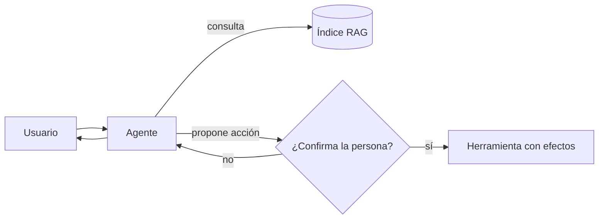

# Ficha de patrón del agente · <reto>

> Sesión 7. Una página. Justificad cada decisión: la respuesta por defecto es «la solución más simple que funcione».

## 1. Objetivo en una frase

<El asistente ayuda a [usuario] a [tarea] para conseguir [resultado medible].>

## 2. Patrón elegido

| Opción | ¿Sirve? | Motivo |
| --- | --- | --- |
| Prompt único | Sí / No | |
| Workflow fijo (pasos en código) | Sí / No | |
| Enrutador (clasifica y deriva) | Sí / No | |
| Agente con herramientas (ReAct) | Sí / No | |
| Planificar-ejecutar | Sí / No | |
| Multiagente | Sí / No | |

**Patrón elegido:** <...> **porque** <...>. **No elegimos uno más simple porque** <...>.

## 3. Herramientas previstas

| Herramienta | Qué hace | Solo lectura / con efectos | Sistema del cliente |
| --- | --- | --- | --- |
| `buscar_documentacion` | Busca en el índice RAG | Solo lectura | Documentación de Atlántica |
| | | | |

## 4. Bucle

- Máximo de pasos: <6>
- Termina cuando: <el modelo responde sin pedir herramientas / se alcanza el máximo / se detecta un bucle>
- Si una herramienta falla: <el error vuelve al modelo como texto; tras 2 fallos responde con lo que tiene y lo indica>

## 5. Puntos de intervención humana

| Momento | Qué decide la persona | Cómo se presenta |
| --- | --- | --- |
| | | |

## 6. Diagrama

