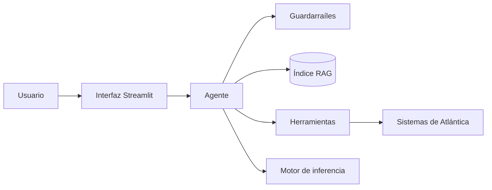

# Propuesta técnica · <reto>

> Sesión 13. Documento que entregaríais al cliente para aprobar el paso a piloto.

## 1. Arquitectura

<Explicación de cada componente en 1-2 líneas.>

## 2. Modelo y motor de inferencia

| Decisión | Elección | Alternativas evaluadas | Evidencia (métrica) |
| --- | --- | --- | --- |
| Modelo de chat | | | |
| Modelo de embeddings | | | |
| Motor en desarrollo | Ollama / LM Studio | | |
| Motor en piloto | Ollama servidor / vLLM / Colibri | | Prueba de carga |

## 3. RAG

| Aspecto | Decisión | Por qué |
| --- | --- | --- |
| Fuentes | | |
| Troceado | | |
| Búsqueda | semántica / BM25 / híbrida (RRF) | hit@k, MRR |
| `k` | | |
| Actualización | incremental por huella | |

## 4. Herramientas y permisos

| Herramienta | Permiso | Confirmación humana |
| --- | --- | --- |

## 5. Guardarraíles

<Por capas: entrada, herramientas, salida. Resultado del red teaming.>

## 6. Framework

<Enlace al ADR de la sesión 10 (`docs/adr/0001-...md`).>

## 7. Requisitos de hardware y despliegue

| Escenario | Usuarios simultáneos | Hardware | Latencia p95 medida |
| --- | --- | --- | --- |
| Desarrollo | 1 | Portátil 16 GB | |
| Piloto | | | |
| Producción | | | |
