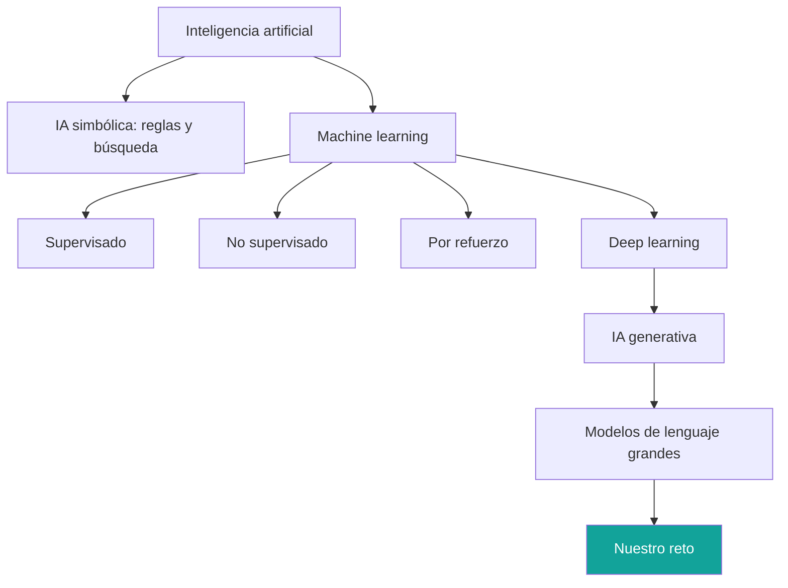

# Práctica 1. Equipos, mapa conceptual y clasificación de casos

Duración: Reto 1 (70 min) y Reto 2 (56 min).
Entregable del equipo: `docs/mapa_conceptual.md` y `docs/clasificacion_casos.md` en el repositorio del equipo.

## Reto 1. Formación de equipos y mapa conceptual (70 min)

### 1. Formación de equipos (10 min)

El docente forma tres equipos de cuatro personas equilibrando perfiles (desarrollo, infraestructura y datos) y asigna los retos:

| Equipo | Reto | Ámbito |
| --- | --- | --- |
| Equipo 1 | R1 · DevAssist | Desarrollo de software |
| Equipo 2 | R2 · InfraPilot | Infraestructura como código |
| Equipo 3 | R3 · PMO Copilot | Gestión de proyectos TI |

Cada equipo:

1. Crea su repositorio a partir de la plantilla `equipos/plantilla_proyecto/` (instrucciones en `equipos/README.md`).
2. Reparte los roles del primer hito: responsable de producto y calidad, ingeniería de IA, ingeniería de conocimiento e ingeniería de integración.
3. Lee la descripción de su reto en `equipos/README.md`.

### 2. Mapa conceptual colaborativo (60 min)

Construid un mapa conceptual de la inteligencia artificial en Markdown con un diagrama [Mermaid](https://mermaid.js.org/), que GitHub y VS Code muestran como imagen.

Requisitos mínimos:

- Los cinco niveles: IA, machine learning, deep learning, IA generativa y LLM, con su relación de inclusión.
- Las tres familias de machine learning con un ejemplo de Atlántica cada una.
- Al menos seis tipos de modelo del apartado 1.4 conectados con su familia.
- Cuatro hitos históricos, situados en el nivel que impulsaron.
- Dónde encaja vuestro reto: marcadlo con un estilo distinto.

Punto de partida:

Debajo del diagrama, escribid un párrafo de 5 a 8 líneas que explique el mapa a alguien de negocio.

## Reto 2. Clasificación de 6 casos de uso (56 min)

1. Cada equipo recibe del docente **6 casos de uso nuevos** de su ámbito (distintos de los de `casos_uso.json`).
2. Clasificad cada caso con la misma ficha del ejercicio 1: paradigma, tipo de modelo y justificación. Añadid dos columnas más:
   - **Riesgo si se equivoca** (bajo, medio o alto) y por qué.
   - **¿Haría falta supervisión humana?** (sí o no).
3. Pedid la misma clasificación al modelo con vuestro código del ejercicio 2 y anotad las discrepancias.
4. Escribid la ficha en `docs/clasificacion_casos.md`.

## Entrega

1. `docs/mapa_conceptual.md` con el diagrama Mermaid y el párrafo explicativo.
2. `docs/clasificacion_casos.md` con la tabla de 6 casos y una sección «Discrepancias con el modelo».
3. Captura de `comprobar_entorno.py` sin errores de cada persona, en `docs/entorno/`.
4. Commit con el mensaje `Sesión 1: mapa conceptual y clasificación de casos`.

## Criterios de evaluación (0 a 3 puntos cada uno)

| Criterio | 3 puntos |
| --- | --- |
| Corrección conceptual | Relaciones de inclusión correctas y ejemplos bien asignados |
| Clasificación | Paradigmas razonables y justificados en términos de datos, coste y riesgo |
| Pensamiento crítico | Las discrepancias con el modelo se analizan, no solo se listan |
| Entorno | Las cuatro personas tienen el entorno verificado |
