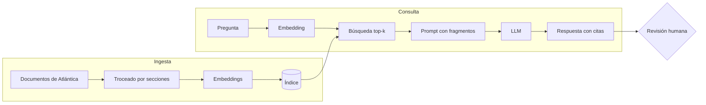

# Práctica 5. Arquitectura RAG del asistente y decisiones justificadas

Entregables del equipo: `docs/arquitectura_rag.md` y tres ADR en `docs/adr/`.

## Reto 1. Diseño de la arquitectura RAG (70 min)

### 1. Inventario de fuentes (20 min)

Haced una tabla con las fuentes de conocimiento que necesita vuestro asistente:

| Fuente | Formato | Tamaño (tokens) | Frecuencia de cambio | Clasificación | ¿RAG, contexto fijo o herramienta? |
| --- | --- | --- | --- | --- | --- |

Fuentes por reto:

| Reto | Fuentes principales |
| --- | --- |
| R1 · DevAssist | Guía de estilo, arquitectura de referencia, código de `tarifas/`, procedimiento de cambios |
| R2 · InfraPilot | Política de infraestructura, catálogo de módulos, procedimiento de cambios, política de seguridad |
| R3 · PMO Copilot | Metodología de proyectos, actas, backlog, informe de estado anterior |

Pista: no todo es RAG. El backlog es un dato estructurado que se consulta con una herramienta (sesión 9); el catálogo de módulos quizá quepa entero en el contexto.

### 2. Diagrama (30 min)

Dibujad la arquitectura de vuestro asistente en Mermaid, con los flujos de ingesta y de consulta, y señalad qué componente es RAG, cuál es una herramienta y dónde interviene una persona.

### 3. Prueba de concepto (20 min)

Adaptad vuestro `s05_ej2_rag_minimo.py` a las fuentes de vuestro reto y probadlo con 5 preguntas de vuestro conjunto dorado. Anotad qué recupera.

## Reto 2. Decisiones justificadas y revisión cruzada (56 min)

### 1. Tres ADR (36 min)

Escribid tres ADR en `docs/adr/` con el formato del apartado 5.5. Temas obligatorios:

1. **Estrategia de troceado** (con los datos del ejercicio 1).
2. **Qué fuentes van por RAG, cuáles en contexto fijo y cuáles por herramienta.**
3. Uno a elegir: modelo de embeddings, valor de `k`, política de abstención, o cómo se respetan los permisos de los documentos.

Cada ADR debe incluir al menos dos alternativas consideradas y sus consecuencias.

### 2. Revisión cruzada (20 min)

Cada equipo revisa la arquitectura de otro (1 → 2 → 3 → 1) y deja tres comentarios en su repositorio (issue o fichero `docs/revision_cruzada.md`): un acierto, un riesgo y una pregunta.

## Entrega

1. `docs/arquitectura_rag.md`: inventario de fuentes, diagrama y resultados de la prueba de concepto.
2. `docs/adr/ADR-001.md`, `ADR-002.md` y `ADR-003.md`.
3. Respuesta a la revisión cruzada recibida.
4. Commit: `Sesión 5: arquitectura RAG y ADR`.

## Criterios de evaluación (0 a 3 puntos cada uno)

| Criterio | 3 puntos |
| --- | --- |
| Inventario | Completo y con la vía correcta para cada fuente |
| Diagrama | Ingesta, consulta, herramientas y punto humano claros |
| ADR | Contexto, alternativas y consecuencias reales; decisiones basadas en datos |
| Revisión cruzada | Comentarios útiles dados y respondidos |
