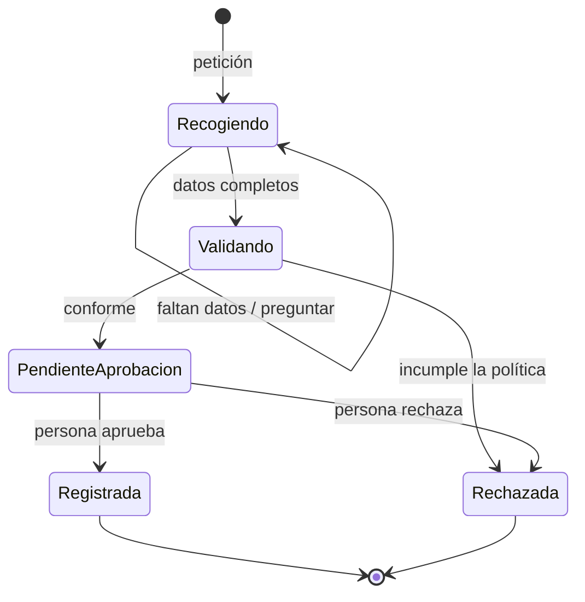

# Sesión 8. Agentes: planificación, memoria, estado y guardarraíles

<!-- cabecera:inicio -->
| Fecha | Horario | Modalidad | Módulos | Hito |
| --- | --- | --- | --- | --- |
| Martes 15 de diciembre de 2026 | 09:00-15:00 | Remoto | M5 · Agentic AI y herramientas avanzadas (6 h) | H3 · Sistema agéntico |

**Objetivo:** Diseñar un agente con plan, memoria mínima y límites operativos claros.
<!-- cabecera:fin -->

Al terminar esta sesión sabrás diseñar un agente con un plan, una memoria mínima y **límites operativos claros**, y sabrás depurarlo leyendo sus trazas. Verás los dos patrones de razonamiento más usados (ReAct y planificar-ejecutar) y los guardarraíles que separan una demo de un sistema que se puede poner delante de un cliente.

<!-- agenda:inicio -->
### Agenda de la sesión

| Hora | Min | Tipo | Bloque |
| --- | --- | --- | --- |
| 09:00 | 15 | Teoría | Activación: el agente que se pasó de listo |
| 09:15 | 55 | Teoría | Teoría I: patrones ReAct y planificar-ejecutar |
| 10:10 | 70 | Práctica | Laboratorio: agente ReAct con tool calling y trazas |
| 11:20 | 10 | Pausa | Pausa |
| 11:30 | 50 | Teoría | Teoría II: memoria, estado y guardarraíles |
| 12:20 | 70 | Práctica | Reto 1: prototipo del agente del equipo |
| 13:30 | 10 | Pausa | Pausa |
| 13:40 | 56 | Práctica | Reto 2: guardarraíles y registro de errores |
| 14:36 | 24 | Teoría | Cierre: lectura de trazas en grupo |

Teoría: 2 h 24 min · práctica: 3 h 36 min (las pausas computan en el bloque práctico).
<!-- agenda:fin -->

## Lo que entregas hoy

| Entregable | Dónde | Quién |
| --- | --- | --- |
| Especificación del agente | `docs/especificacion_agente.md` del repositorio del equipo | Equipo |
| Prototipo del agente para una tarea acotada | `agente/` | Equipo |
| Registro de trazas y errores | `docs/registro_errores.md` y `trazas/` | Equipo |
| Ejercicios 1 a 4 con los tests en verde | `sesion_08_planificacion_memoria/ejercicios/` | Cada persona |

---

## 8.1 ReAct: razonar, actuar, observar

**ReAct** (*Reasoning + Acting*) es el patrón del bucle que programaste en la sesión 7: en cada paso el modelo decide la siguiente acción a la vista de lo observado hasta ahora.

```
Objetivo ──► [Modelo decide] ──► acción (herramienta) ──► observación ──┐
                   ▲                                                      │
                   └──────────────────────────────────────────────────────┘
             ... hasta que el modelo responde sin acción
```

| Ventaja | Inconveniente |
| --- | --- |
| Se adapta a lo que va encontrando | Difícil de prever y de probar |
| Sencillo de implementar con tool calling | Cada paso es una llamada al modelo: coste y latencia |
| Bueno para investigar o diagnosticar | Puede dar vueltas, repetir acciones o desviarse |

## 8.2 Planificar y ejecutar

En **planificar-ejecutar** (*plan-and-execute*) el modelo propone primero un plan completo, el programa lo valida (y una persona lo puede aprobar) y después se ejecuta paso a paso.

| Ventaja | Inconveniente |
| --- | --- |
| El plan se puede revisar antes de actuar | El plan se hace sin ver los resultados intermedios |
| Menos llamadas al modelo | Si un paso depende de otro, el planificador tiene que saber expresar esa dependencia |
| Fácil de auditar | Hay que replanificar si algo falla |

Un fallo típico, que verás hoy con el modelo real: el planificador escribe pasos como `calcular("2 * precio_m6i_large")`, con variables que no existen porque el precio todavía no se conoce cuando se hace el plan. Soluciones: pasos con referencias explícitas a resultados anteriores, **replanificar** tras cada paso que aporte datos, o combinar los patrones (plan de alto nivel y ReAct dentro de cada paso).

---

## 8.3 Memoria

Un LLM no recuerda nada entre llamadas. La «memoria» de un agente es información que **tu programa** guarda y vuelve a poner en el contexto.

| Tipo | Qué guarda | Implementación | Riesgo |
| --- | --- | --- | --- |
| Corto plazo: ventana | Los últimos N mensajes | Recortar el historial | Olvida lo antiguo |
| Corto plazo: resumen | Un resumen de lo antiguo + lo reciente | Resumir con el LLM al superar un umbral de tokens | El resumen puede perder o deformar datos |
| Estado de trabajo | Datos estructurados de la tarea en curso | Un objeto (`EstadoPeticion`) que se actualiza en cada paso | Ninguno grave: es la opción más fiable |
| Largo plazo: hechos | Preferencias o datos estables de la persona usuaria | Clave-valor o base vectorial | Datos personales: privacidad y caducidad |
| Largo plazo: episodios | Qué funcionó en tareas anteriores | Base vectorial de casos | Contaminación con casos erróneos |

**Regla práctica: lo que importa para decidir debe estar en un estado estructurado, no solo en el historial.** Si InfraPilot necesita saber el centro de coste, que lo guarde en un campo, no que confíe en encontrarlo en el mensaje número 14.

---

## 8.4 Estado y control del flujo

Tratar al agente como una **máquina de estados** lo hace predecible:



Con estados explícitos sabes qué herramientas tiene sentido permitir en cada momento (no se puede registrar un cambio en el estado «Recogiendo») y puedes guardar el estado para continuar más tarde. LangGraph (sesión 10) formaliza esta idea.

---

## 8.5 Guardarraíles

Un **guardarraíl** es un control que limita lo que puede entrar, lo que puede hacer y lo que puede salir del agente. Se diseñan en capas, porque ninguno es infalible:

| Capa | Control | Ejemplo en Atlántica |
| --- | --- | --- |
| Entrada | Detectar intentos de inyección | «Ignora tus instrucciones…» en un correo o en un documento |
| Entrada | Ocultar datos personales antes de enviarlos al modelo | DNI, teléfono, matrícula del conductor |
| Herramientas | Lista blanca: solo las herramientas necesarias | PMO Copilot no tiene herramientas de infraestructura |
| Herramientas | Mínimo privilegio | Leer el backlog sí; borrar historias no |
| Herramientas | **Confirmación humana** para acciones con efectos | Registrar una solicitud de cambio, actualizar el estado de una historia |
| Límites | Máximo de pasos, de tiempo, de llamadas, de coste | 8 pasos, 120 s |
| Límites | Detección de bucles | La misma llamada con los mismos argumentos más de dos veces |
| Salida | Validación del formato y de reglas de negocio | El Terraform no tiene buckets públicos |
| Salida | Verificación de hechos y de cifras | Cada importe de la respuesta aparece en algún resultado de herramienta |

### La inyección de instrucciones es un problema abierto

Un modelo no distingue de forma fiable entre instrucciones de quien lo programó y texto que «parece» una instrucción dentro de los datos (un correo, un documento recuperado, la respuesta de una API). Los detectores por patrones ayudan, pero se saltan con facilidad. La defensa que funciona es de arquitectura: **aunque el agente sea engañado, que no pueda hacer daño**. Por eso el mínimo privilegio y la confirmación humana son los controles más importantes.

### Supervisión humana bien diseñada

«Humano en el bucle» solo es un control si la persona recibe la información necesaria para decidir: qué acción, con qué argumentos, por qué y qué consecuencias tiene. Un botón de «Aceptar» que se pulsa sin leer no es supervisión.

---

## 8.6 Trazas: cómo se depura un agente

Un agente que falla en producción solo se puede diagnosticar si cada ejecución deja una **traza**: objetivo, cada decisión del modelo, cada herramienta con sus argumentos y su resultado, tiempos y motivo de parada. El curso usa `comun/trazas.py`, que escribe una línea JSON por paso en `trazas/`.

Cómo leer una traza:

1. ¿Qué buscó y qué le devolvió la búsqueda? Muchos errores empiezan en una recuperación pobre.
2. ¿Cada dato de la respuesta final aparece en algún resultado de herramienta? Si no, lo ha inventado.
3. ¿Usó las herramientas que debía? (por ejemplo, `calcular` para las cuentas).
4. ¿Por qué terminó? Respuesta, máximo de pasos o bucle.

### Taxonomía de errores de agentes

| Error | Ejemplo |
| --- | --- |
| Recuperación insuficiente | Busca «t3.medium cost» y recibe la política de costes en lugar del catálogo |
| Datos inventados | Usa precios que no aparecen en ningún resultado |
| Herramienta equivocada o no usada | Hace la cuenta «de cabeza» |
| Argumentos inválidos | Pasa variables inexistentes a `calcular` |
| Objetivo malinterpretado | Responde para el entorno `dev` cuando se preguntó por `pre` |
| Bucle | Repite la misma búsqueda |
| Exceso de autonomía | Intenta una acción que no le corresponde |

En la práctica de hoy registraréis los errores de vuestro agente con esta taxonomía.

---

## Errores frecuentes

| Error | Síntoma | Solución |
| --- | --- | --- |
| Confiar en el historial para los datos clave | El agente «olvida» el centro de coste | Estado estructurado |
| Guardarraíles solo en el prompt | El modelo se los salta | Controles en el código: lista blanca, confirmación, límites |
| No guardar trazas | Imposible saber por qué falló | `Traza` en cada ejecución |
| Pedir confirmación para todo | La persona aprueba sin leer | Solo para acciones con efectos, con información suficiente |
| Ocultar datos después de llamar al modelo | Los datos ya salieron | Ocultar antes de construir el prompt |

## Para saber más

- Yao et al. (2022), *ReAct: Synergizing Reasoning and Acting in Language Models*: [arxiv.org/abs/2210.03629](https://arxiv.org/abs/2210.03629)
- OWASP, *Top 10 for Large Language Model Applications*: [genai.owasp.org](https://genai.owasp.org/)
- Simon Willison, artículos sobre *prompt injection*: [simonwillison.net/tags/prompt-injection](https://simonwillison.net/tags/prompt-injection/)
