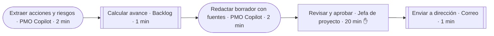

# Sesión 11. Automatización con agentes · Asistentes inteligentes y chatbots

<!-- cabecera:inicio -->
| Fecha | Horario | Modalidad | Módulos | Hito |
| --- | --- | --- | --- | --- |
| Viernes 18 de diciembre de 2026 | 09:00-15:00 | Remoto | M5 · Agentic AI y herramientas avanzadas (2 h) + M6 · Aplicaciones prácticas de IA Generativa (4 h) | H4 · Aplicación y proyecto |

**Objetivo:** Convertir un proceso en un flujo automatizable y definir una experiencia conversacional útil.
<!-- cabecera:fin -->

Al terminar esta sesión sabrás analizar un proceso de negocio para decidir qué partes automatizar con IA y dónde debe intervenir una persona, y sabrás diseñar y construir un asistente conversacional útil, transparente y con interfaz. Empieza el Hito 4: el asistente de tu equipo tendrá hoy su primera versión utilizable.

<!-- agenda:inicio -->
### Agenda de la sesión

| Hora | Min | Tipo | Módulo | Bloque |
| --- | --- | --- | --- | --- |
| 09:00 | 15 | Teoría | M5 | Activación: ¿qué tarea quitarías de tu semana? |
| 09:15 | 45 | Teoría | M5 | Teoría: automatización de procesos con agentes |
| 10:00 | 60 | Práctica | M5 | Laboratorio: mapa AS-IS/TO-BE del proceso del reto |
| 11:00 | 10 | Pausa | M6 | Pausa |
| 11:10 | 60 | Teoría | M6 | Teoría: asistentes inteligentes y chatbots |
| 12:10 | 66 | Práctica | M6 | Laboratorio: interfaz de chat con Streamlit |
| 13:16 | 80 | Práctica | M6 | Reto: primer incremento del asistente y backlog priorizado |
| 14:36 | 24 | Teoría | M6 | Cierre: demo rápida de cada equipo |

Teoría: 2 h 24 min · práctica: 3 h 36 min (las pausas computan en el bloque práctico).
<!-- agenda:fin -->

## Lo que entregas hoy

| Entregable | Dónde | Quién |
| --- | --- | --- |
| Mapa AS-IS / TO-BE del proceso del reto | `docs/proceso_as_is_to_be.md` del repositorio del equipo | Equipo |
| Backlog priorizado del asistente | `docs/backlog_asistente.md` | Equipo |
| Prototipo inicial con interfaz | `app.py` | Equipo |
| Ejercicios 1 a 4 con los tests en verde | `sesion_11_automatizacion_asistentes/ejercicios/` | Cada persona |

---

## 11.1 Automatizar procesos con agentes

La pregunta que te hará un cliente no es «¿qué puede hacer la IA?», sino «¿qué parte de mi trabajo puedo dejar de hacer?». Para responderla con rigor hay que analizar el proceso, no la tecnología.

### Qué tareas son buenas candidatas

| Señal | Buena candidata | Mala candidata |
| --- | --- | --- |
| Volumen | Se repite muchas veces | Ocurre dos veces al año |
| Entrada | Texto, documentos, correos: lenguaje natural | Datos ya estructurados (mejor un programa clásico) |
| Variabilidad | Cada caso es algo distinto, pero dentro de un patrón | Totalmente impredecible |
| Coste del error | Bajo o detectable antes de que tenga efectos | Alto e irreversible |
| Verificación | Una persona puede revisar rápido el resultado | Revisar cuesta lo mismo que hacerlo |

El último punto es decisivo y suele olvidarse: **si revisar el resultado de la IA cuesta lo mismo que hacer el trabajo, no hay ahorro.**

### Niveles de automatización

| Nivel | Quién hace qué | Ejemplo |
| --- | --- | --- |
| 1. Asistencia | La IA sugiere, la persona hace | Borrador del informe que la jefa de proyecto reescribe |
| 2. Automatización supervisada | La IA hace, la persona aprueba antes de que tenga efecto | Solicitud de cambio preparada por InfraPilot y aprobada en el CAB |
| 3. Automatización con excepciones | La IA hace y solo escala los casos dudosos | Clasificación de incidencias: las P1 y las dudosas van a una persona |
| 4. Autonomía | La IA hace sin supervisión | Raramente justificable con LLM en procesos con efectos |

Casi todo lo que harás en proyectos reales estará en los niveles 1 a 3.

## 11.2 Mapas AS-IS y TO-BE

1. **AS-IS**: el proceso actual, paso a paso, con actor, tipo (manual o automático) y tiempo. Se obtiene entrevistando a quien lo hace, no imaginándolo.
2. **TO-BE**: el proceso propuesto, con los pasos que hace la IA, los automáticos y los **puntos de control humano**.
3. **Comparación**: tiempo antes y después, porcentaje automatizado y dónde están los controles.

Reglas de diseño del TO-BE:

- Todo paso de IA con efectos tiene después un control humano.
- El control humano lo hace una persona con información suficiente para decidir.
- Se mide el tiempo de revisión, no solo el de generación.



En el ejemplo, el informe semanal pasa de 145 a 26 minutos (un 82 % menos), con la persona como responsable final.

---

## 11.3 Asistentes inteligentes y chatbots

| | Chatbot | Asistente inteligente |
| --- | --- | --- |
| Alcance | Responder preguntas de un dominio | Ayudar a completar tareas |
| Conocimiento | FAQ o RAG | RAG más herramientas |
| Memoria | La conversación | La conversación y el estado de la tarea |
| Acciones | Ninguna | Consultar y, con confirmación, modificar sistemas |
| Ejemplo | «¿Cuántos días de vacaciones tengo?» | «Prepárame la petición de entorno para pre» |

## 11.4 Diseño conversacional

Un asistente útil no es solo un buen modelo: es una buena conversación.

| Elemento | Buena práctica |
| --- | --- |
| Bienvenida | Quién es, que es una IA, qué puede hacer y qué no |
| Transparencia | Obligatoria si habla con personas externas (Reglamento Europeo de IA, riesgo limitado) |
| Tono | El de la empresa: claro, breve, sin falsa empatía |
| Aclaraciones | Pregunta lo que falta en lugar de suponer, de una en una |
| Fuentes | Indica de dónde sale cada dato importante |
| Errores | Admite lo que no sabe y propone alternativa |
| Traspaso a una persona | Detecta cuándo hace falta (petición explícita, queja, tema sensible) y lo hace sin fricción |
| Límites de memoria | Ventana o resumen; reiniciar conversación |
| Datos personales | No pide más de lo necesario; no los guarda sin motivo |

## 11.5 Interfaz con Streamlit

**Streamlit** convierte un script de Python en una aplicación web. Tiene componentes de chat y un estado por sesión del navegador:

```python
import streamlit as st

if "mensajes" not in st.session_state:
    st.session_state["mensajes"] = []

for m in st.session_state["mensajes"]:
    with st.chat_message(m["rol"]):
        st.markdown(m["texto"])

if pregunta := st.chat_input("Escribe tu pregunta"):
    ...
```

Cosas que tienes que saber:

- **El script se vuelve a ejecutar entero en cada interacción.** Lo que debe sobrevivir entre interacciones va en `st.session_state`.
- Separa la lógica (el `Asistente`) de la interfaz: así la lógica se prueba con pytest y la interfaz solo dibuja.
- Streamlit también se puede probar sin navegador con `streamlit.testing.v1.AppTest`.
- Se lanza con `streamlit run app.py` y se abre en `http://localhost:8501`.

Alternativas: Gradio (muy rápido para demos), Open WebUI (interfaz completa de chat para servidores de modelos) o una interfaz propia con FastAPI y un frontal web.

## 11.6 El backlog del asistente

Ningún asistente sale completo en la primera versión. Gestiona sus funcionalidades como cualquier producto:

- **Historias de usuario** con criterios de aceptación (ya sabes escribirlas: lo hace PMO Copilot).
- **Priorización MoSCoW**: *Must* (imprescindible para el MVP), *Should*, *Could* y *Won't* (no en esta versión).
- **Valor frente a esfuerzo** para ordenar dentro de cada grupo.
- Las historias de **evaluación y seguridad** también son *Must*: un asistente que no se puede evaluar no se puede entregar.

---

## Errores frecuentes

| Error | Síntoma | Solución |
| --- | --- | --- |
| Automatizar sin medir el AS-IS | No se puede demostrar el ahorro | Medir tiempos antes de diseñar |
| Ignorar el tiempo de revisión | El ahorro real es mucho menor | Medir la revisión en el TO-BE |
| Chatbot sin bienvenida ni aviso de IA | Expectativas erróneas e incumplimiento | Bienvenida transparente |
| Guardar el estado en variables globales en Streamlit | Se pierde en cada interacción o se mezcla entre usuarios | `st.session_state` |
| Mezclar lógica e interfaz | No se puede probar | Clase `Asistente` separada |

## Para saber más

- Documentación de Streamlit para aplicaciones de chat: [docs.streamlit.io/develop/tutorials/chat-and-llm-apps](https://docs.streamlit.io/develop/tutorials/chat-and-llm-apps)
- Google, *Conversation design guidelines*: [developers.google.com/assistant/conversation-design](https://developers.google.com/assistant/conversation-design/welcome)
- Reglamento Europeo de IA, artículo 50 (obligaciones de transparencia).
